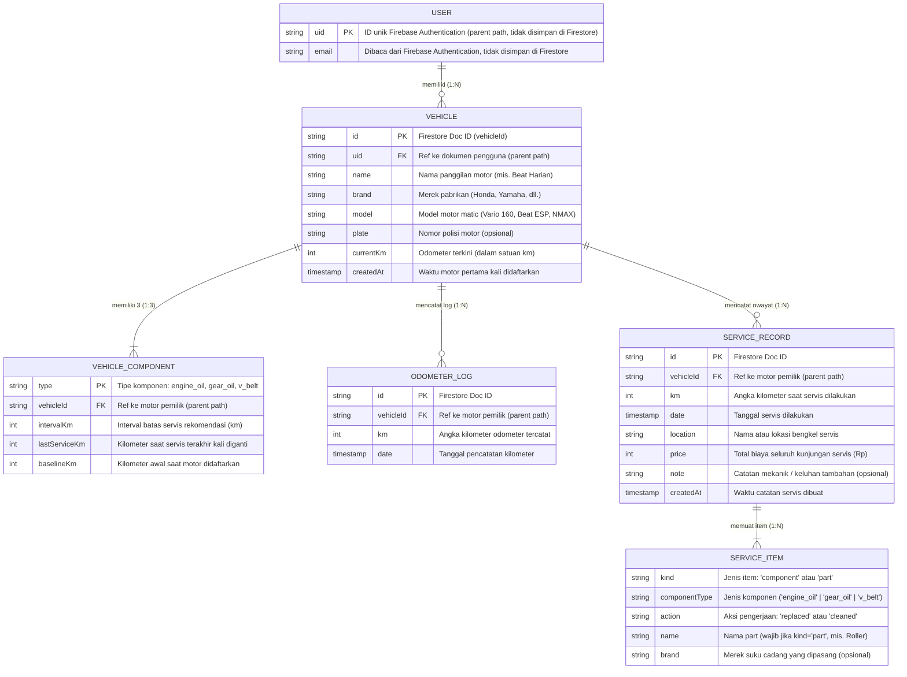

# Entity Relationship Diagram (ERD): MotoCare

Dokumen ini mendefinisikan struktur data, entitas, atribut, dan hubungan antarentitas dalam aplikasi **MotoCare** sesuai dengan spesifikasi di [SPEC.md](file:///home/masapis/Projects/motocare/docs/SPEC.md#L127-L145).

MotoCare menggunakan basis data NoSQL Cloud Firestore dengan struktur hierarki subkoleksi bertingkat di bawah dokumen pengguna (`users/{uid}`).

---

## 1. Diagram ERD (Mermaid)



---

## 2. Struktur Path Firestore (Struktur Fisik)

Di Cloud Firestore, hubungan antar-tabel diimplementasikan melalui struktur subkoleksi bersarang (*nested subcollections*) sebagai berikut:

```text
users/{uid}                                            [Dokumen Pengguna]
  └─ vehicles/{vehicleId}                              [Koleksi Motor Pengguna]
       ├─ components/{type}                            [Subkoleksi Komponen (3 dokumen)]
       ├─ odometerLogs/{id}                            [Subkoleksi Log Odometer]
       └─ serviceRecords/{id}                          [Subkoleksi Riwayat Servis]
            └─ (embedded array) items: [ {...}, ... ]  [Array Dokumen Embedded Item Servis]
```

---

## 3. Kamus Data & Spesifikasi Entitas

### 3.1 Entitas `USER` (Pengguna)
Identitas pemilik akun dikelola sepenuhnya oleh Firebase Authentication (email + kata sandi). Aplikasi **tidak menulis dokumen** `users/{uid}`; dokumen itu hanya dipakai sebagai *parent path* untuk subkoleksi motor, sehingga di Firestore ia bisa tampak sebagai dokumen kosong.
- **Path Firestore:** `users/{uid}` (tanpa field yang ditulis aplikasi)
- **Primary Key:** `uid` (string, sama dengan `FirebaseAuth.currentUser.uid`)
- **Field yang tersedia di aplikasi:** `uid` dan `email` dibaca dari Firebase Authentication, tidak disimpan ke Firestore.

---

### 3.2 Entitas `VEHICLE` (Kendaraan / Motor)
Menyimpan identitas motor matic yang dipantau oleh pengguna. Satu pengguna dapat memiliki lebih dari satu motor (multi-kendaraan).
- **Path Firestore:** `users/{uid}/vehicles/{vehicleId}`
- **Primary Key:** `id` / `vehicleId` (string auto-generated Firestore)
- **Foreign Key:** `uid` (didapat dari parent document path)

| Kolom / Field | Tipe Data | Wajib | Keterangan |
|---|---|:---:|---|
| `id` | String | Ya | ID unik dokumen motor di Firestore. |
| `name` | String | Ya | Nama panggilan motor (misal: "Vario Kampus"). |
| `brand` | String | Ya | Merek pabrikan (Honda, Yamaha, Suzuki, Vespa, dll.). |
| `model` | String | Ya | Model varian motor (misal: "Vario 160", "BeAT Street"). |
| `plate` | String | Tidak | Nomor plat polisi (misal: "B 1234 CD"). |
| `currentKm` | Integer | Ya | Angka kilometer terkini pada odometer motor. |
| `createdAt` | Timestamp | Ya | Tanggal & waktu motor didaftarkan pertama kali. |

---

### 3.3 Entitas `VEHICLE_COMPONENT` (Komponen Motor)
Menyimpan status sisa usia pakai untuk 3 komponen matic utama yang wajib dipantau per motor.
- **Path Firestore:** `users/{uid}/vehicles/{vehicleId}/components/{type}`
- **Primary Key:** `type` (String: `engine_oil`, `gear_oil`, `v_belt`)
- **Foreign Key:** `vehicleId` (didapat dari parent path)

| Kolom / Field | Tipe Data | Wajib | Keterangan |
|---|---|:---:|---|
| `type` | String | Ya | Jenis komponen: `engine_oil` (oli mesin), `gear_oil` (oli gardan), `v_belt` (V-belt). |
| `intervalKm` | Integer | Ya | Rekomendasi batas jarak servis (Default: Oli mesin 2.000 km, Oli gardan 8.000 km, V-belt 20.000 km). |
| `lastServiceKm`| Integer | Ya | Nilai odometer saat komponen terakhir diganti. |
| `baselineKm` | Integer | Ya | Nilai odometer saat motor pertama kali dibuat (acuan fallback jika riwayat servis dihapus). |

---

### 3.4 Entitas `ODOMETER_LOG` (Catatan Kilometer)
Mencatat riwayat pembaruan kilometer odometer motor untuk menghitung rata-rata jarak tempuh harian.
- **Path Firestore:** `users/{uid}/vehicles/{vehicleId}/odometerLogs/{id}`
- **Primary Key:** `id` (string auto-generated Firestore)
- **Foreign Key:** `vehicleId` (didapat dari parent path)

| Kolom / Field | Tipe Data | Wajib | Keterangan |
|---|---|:---:|---|
| `id` | String | Ya | ID unik catatan log odometer. |
| `km` | Integer | Ya | Angka kilometer yang diinputkan (Validasi: $\ge$ KM sebelumnya). |
| `date` | Timestamp | Ya | Tanggal pencatatan odometer (default hari ini). |

---

### 3.5 Entitas `SERVICE_RECORD` (Catatan Servis Bengkel)
Mencatat satu kali kunjungan ke bengkel, mencakup total biaya, tanggal, dan nama bengkel.
- **Path Firestore:** `users/{uid}/vehicles/{vehicleId}/serviceRecords/{id}`
- **Primary Key:** `id` (string auto-generated Firestore)
- **Foreign Key:** `vehicleId` (didapat dari parent path)

| Kolom / Field | Tipe Data | Wajib | Keterangan |
|---|---|:---:|---|
| `id` | String | Ya | ID unik dokumen servis. |
| `date` | Timestamp | Ya | Tanggal servis dilaksanakan. |
| `km` | Integer | Ya | Angka kilometer motor saat masuk bengkel. |
| `location` | String | Ya | Nama atau lokasi bengkel servis. |
| `price` | Integer | Ya | Total biaya servis satu kunjungan dalam Rupiah (bilangan bulat $\ge 0$). |
| `note` | String | Tidak | Catatan tambahan teknisi atau keluhan motor. |
| `createdAt` | Timestamp | Tidak | Waktu pembuatan dokumen data. |
| `items` | Array[Object] | Ya | Daftar rincian pekerjaan atau suku cadang (lihat `SERVICE_ITEM`). |

---

### 3.6 Entitas `SERVICE_ITEM` (Item Pekerjaan Servis)
Objek tersimpan di dalam array `items` pada dokumen `SERVICE_RECORD` (arsitektur *embedded document*).

| Kolom / Field | Tipe Data | Wajib | Keterangan |
|---|---|:---:|---|
| `kind` | String | Ya | Kategori item: `"component"` (komponen utama) atau `"part"` (suku cadang tambahan). |
| `componentType`| String | Kondisional | Wajib jika `kind = "component"` (`engine_oil`, `gear_oil`, atau `v_belt`). |
| `action` | String | Ya | Aksi perawatan: `"replaced"` (diganti) atau `"cleaned"` (dibersihkan). |
| `name` | String | Kondisional | Nama suku cadang (wajib jika `kind = "part"`, misal: "Roller", "Busi", "Kampas Ganda"). |
| `brand` | String | Tidak | Merek suku cadang (misal: "Motul", "Bando", "Daytona"). |

---

## 4. Aturan Kardinalitas & Integritas Relasi

1. **User ke Vehicle (`1 : 0..N`)**:
   - Satu pengguna dapat memiliki nol, satu, atau banyak motor.
   - Akses data dibatasi oleh Firebase Security Rules: pengguna hanya dapat melihat dan memodifikasi motor miliknya sendiri (`request.auth.uid == uid`).
2. **Vehicle ke VehicleComponent (`1 : 3`)**:
   - Setiap motor matic otomatis memiliki tepat 3 dokumen komponen: `engine_oil`, `gear_oil`, dan `v_belt`.
   - Dibuat otomatis saat motor pertama kali didaftarkan.
3. **Vehicle ke OdometerLog (`1 : 0..N`)**:
   - Setiap perubahan KM odometer dicatat sebagai riwayat log untuk menghitung rata-rata harian (30 hari terakhir).
4. **Vehicle ke ServiceRecord (`1 : 0..N`)**:
   - Satu motor dapat memiliki banyak catatan riwayat kunjungan servis.
   - Jika dokumen kendaraan dihapus, seluruh subkoleksi (`components`, `odometerLogs`, `serviceRecords`) ikut terhapus (*cascading delete*).
5. **ServiceRecord ke ServiceItem (`1 : 1..N`)**:
   - Satu kunjungan servis harus memuat minimal 1 item pekerjaan/penggantian.
   - Suku cadang berstatus `"replaced"` akan memperbarui `lastServiceKm` pada entitas `VEHICLE_COMPONENT` terkait.
